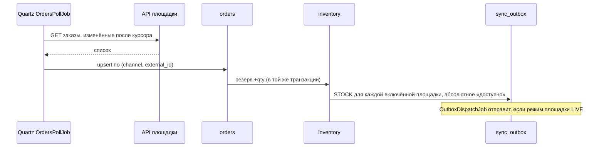

# Архитектура бэкенда

Назад к плану: [`README.md`](README.md).

## 1. Компоненты

| Компонент | Где живёт | Что делает |
| --- | --- | --- |
| Caddy | контейнер на EC2 | Принимает HTTPS на 443, получает и продлевает сертификаты Let's Encrypt, редиректит HTTP → HTTPS, проксирует в приложение |
| Приложение (Spring Boot) | контейнер на EC2 | REST API `/api/**`, собранная админка (статикой), фиды `/feeds/**`, планировщик Quartz, outbox-диспетчер, клиенты API площадок |
| PostgreSQL 17 | контейнер на EC2, том на EBS | Все данные CRM, сессии пользователей, таблицы Quartz, outbox, журналы |
| S3 `media` | AWS | Фото товаров; префикс `products/` читается публично (площадки скачивают фото по URL из фида) |
| S3 `backups` | AWS | Дампы базы |
| ECR | AWS | Docker-образы приложения |
| SSM Parameter Store | AWS | Секреты prod; на сервере из них собирается `.env` |
| CloudWatch | AWS | Логи контейнеров, метрики диска и памяти, алармы |

Это модульный монолит: один процесс, один образ, одна база. Отдельных сервисов, брокеров сообщений и кешей нет — для одного магазина и нескольких тысяч SKU они не нужны.

## 2. Домены и маршруты

| URL | Куда | Доступ |
| --- | --- | --- |
| `https://admin.<domain>/` | админка (SPA, hash-маршруты `#/orders`) | страница входа открыта, данные — после логина |
| `https://admin.<domain>/api/**` | REST API | сессия; кроме `/api/auth/login` |
| `https://admin.<domain>/feeds/{token}/{marketplace}.xml` | фиды для площадок | по секретному токену в пути |
| `https://admin.<domain>/healthz` | короткая проверка живости для внешнего мониторинга | открыт, без подробностей |
| `/actuator/**` | метрики и детальный health | закрыт на уровне Caddy, доступен только изнутри сервера |
| `https://<domain>/` | будущий сайт-витрина | отдельный контейнер позже |

Админка и API на одном origin, поэтому CORS не нужен, а cookie сессии работает без ухищрений.

## 3. Модули монолита

Корневой пакет `com.triomio.crm`. Каждый модуль — пакет верхнего уровня со своими сущностями, сервисами и контроллерами. Другие модули обращаются к нему только через публичный сервис модуля, не через его репозитории. Границы проверяем тестом Spring Modulith ([`10-testing.md`](10-testing.md)).

| Модуль | Отвечает за | Основные таблицы |
| --- | --- | --- |
| `auth` | пользователи, вход, роли, сессии | `users`, `login_attempts`, `spring_session*` |
| `catalog` | товары, категории, бренды, маппинги категорий, готовность к площадкам | `products`, `categories`, `brands`, `category_mappings`, `marketplace_categories` |
| `inventory` | всього / резерв / доступно, ручная правка остатка | `stock` |
| `pricing` | правила цен, расчёт цены для площадки, предпросмотр | `price_rules` |
| `orders` | заказы со всех каналов, ручные заказы, статусы, сроки подтверждения | `orders`, `order_items`, `order_status_history` |
| `integrations` | режимы записи, ключи площадок, outbox, журнал вызовов, сверка | `integration_settings`, `sync_outbox`, `sync_log` |
| `integrations.prom` / `.rozetka` / `.epicentr` | HTTP-клиент, маппинг заказов и статусов, генератор фида конкретной площадки | — |
| `feeds` | сборка и отдача фидов | `feed_builds` |
| `media` | загрузка и хранение фото | `product_images` |
| `audit` | история изменений товара и действий пользователей | `audit_log` |
| `jobs` | конфигурация Quartz, реестр джоб, журнал запусков | `qrtz_*`, `job_runs` |
| `dashboard` | данные для «Огляд» и счётчики меню | — (читает другие модули) |

## 4. Ключевые потоки

### 4.1 Новый заказ с площадки



Курсор опроса — время последнего изменения, которое мы видели, минус 5 минут перекрытия. Повторно полученный заказ ничего не ломает: upsert идемпотентен, а резерв пересчитывается по переходу статуса, а не по факту получения.

### 4.2 Ручной заказ (Instagram и др.)

Менеджер создаёт заказ в админке → тот же сервис `orders` → резерв → outbox. На площадку уходит только новый остаток, сам заказ — нет.

### 4.3 Изменение товара, цены или остатка

Сохранение в админке → транзакция: изменение + запись в `audit_log` + строки в `sync_outbox` (цена и/или остаток для каждой включённой площадки). Контент (названия, описания, фото) уходит не через outbox, а через фид при следующей сборке.

### 4.4 Фид

`FeedBuildJob` раз в час собирает файл для каждой площадки потоковой записью XML в `/data/feeds` на диске сервера. `GET /feeds/{token}/{marketplace}.xml` отдаёт последний собранный файл. Фиды можно пересобрать в любой момент, поэтому их не бэкапим.

## 5. Структура репозитория

```
/                      фронт админки, как сейчас (src/, index.html, vite.config.ts)
backend/               Spring Boot, Maven
  src/main/java/com/triomio/crm/<модуль>/
  src/main/resources/db/migration/   миграции Flyway
deploy/
  Dockerfile           multi-stage: фронт + бэкенд → один образ
  docker-compose.dev.yml
  docker-compose.prod.yml
  Caddyfile
  .env.example         имена переменных без значений
  scripts/             deploy.sh, backup-db.sh, render-env.sh, restore-db.sh
server/                Express-мок; удаляется после паритета API (этап 7.4)
data/                  демо-данные; грузятся только в профиле local
docs/backend/          эти документы
```

Фронт не переносим в `frontend/`, чтобы не ломать сборку демо для GitHub Pages. Если позже понадобится — отдельной задачей.

## 6. Что сознательно не делаем в MVP

- Микросервисы, Kafka/SQS/RabbitMQ, Redis.
- Отдельный staging.
- Горизонтальное масштабирование и балансировщик.
- Webhooks от площадок (их нет — [`../integrations/README.md`](../integrations/README.md)).
- CloudFront.

Условия, при которых к этому возвращаемся, — в таблице решений [`README.md`](README.md) §1.
