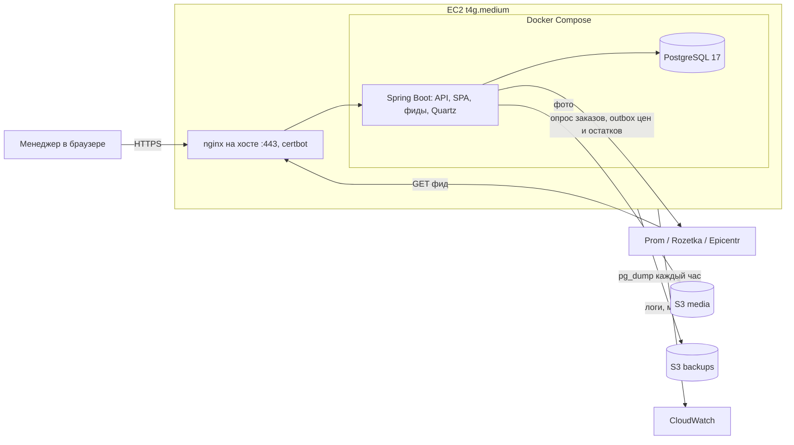

# Бэкенд MVP и развёртывание в AWS

Главный документ по бэкенду CRM Trio Mio: какие технологии берём, как разворачиваем в AWS, какие документы есть и в каком порядке всё делаем. План ниже ведём чекбоксами: шаг отмечается `[x]` в том же PR, который его закрывает, и только когда выполнены **все** критерии приёмки шага.

Продуктовый порядок работ (CRM → площадки → сайт) — в [`../ROADMAP.md`](../ROADMAP.md). Этот документ описывает техническую платформу под него.

## 1. Ключевые решения

Зафиксировано 22.10.2026.

| Тема | Решение | Когда пересмотреть |
| --- | --- | --- |
| Язык и фреймворк | Java 25 LTS + Spring Boot 4.x, Maven | — |
| Фоновые задачи | Quartz с JDBC JobStore в той же PostgreSQL | Второй экземпляр приложения → `isClustered=true` |
| Очереди | Нет брокера. Transactional outbox в PostgreSQL + Quartz-диспетчер | Тысячи событий в минуту |
| База данных | PostgreSQL 17 в Docker на том же EC2; бэкапы `pg_dump` каждый час в S3 + снапшоты диска | Простой из-за БД, рост нагрузки или требование PITR → RDS |
| Хостинг | Один EC2 (Graviton, `t4g.medium`), Docker Compose, монолит | Упор в CPU/RAM или требование HA |
| Окружения | Локальное + prod. Staging нет | Появятся регулярные релизы с риском для продаж |
| Инфраструктура | Вручную в консоли AWS по runbook из `aws/` | Второй экземпляр или второе окружение → Terraform/CDK |
| Фронт админки | Собирается в тот же Docker-образ, отдаётся Spring Boot с того же домена | — |
| Домены | `admin.<domain>` — CRM (API под `/api`); корень `<domain>` — будущий сайт на том же EC2 | Домен ещё не куплен — в документах `<domain>` |
| HTTPS | nginx на хосте EC2 + certbot (Let's Encrypt), страница 503 на время деплоя — как в Lexio | — |
| Аккаунт AWS | Отдельный аккаунт под CRM, не общий с Lexio; лучше — на клиента | — |
| Релизы | Версия `vX.Y.Z`, заметка в `docs/releases/`, git-тег; образ с тегом версии | — |
| CDN | CloudFront не используем; фото отдаются из S3 напрямую | Запуск сайта-витрины или заметный счёт за исходящий трафик S3 |
| Фото | S3, публичное чтение только префикса `products/` | — |
| Авторизация | Свой логин: email + пароль, сессии в PostgreSQL (Spring Session JDBC), роли в БД | Вход покупателей сайта — отдельная тема |
| Секреты | SSM Parameter Store (SecureString) → `.env` на сервере; в репозитории только `.env.example` без значений | — |
| Регион AWS | `eu-central-1` (Франкфурт) | — |
| Запись в площадки | Режимы `OFF` / `READ_ONLY` / `DRY_RUN` / `LIVE` с потолком из env; по умолчанию `READ_ONLY` | Не пересматривается: см. [`LIVE-ACCOUNTS-SAFETY.md`](../integrations/LIVE-ACCOUNTS-SAFETY.md) |

Почему именно так и какие альтернативы отклонены — [`02-tech-stack.md`](02-tech-stack.md).

## 2. Архитектура в двух словах

Один EC2: nginx на хосте принимает HTTPS и проксирует в Docker, где работают два контейнера — приложение Spring Boot (API + собранная админка + фиды + Quartz) и PostgreSQL. Фото и бэкапы лежат в S3. Площадки забирают фиды по URL; заказы мы опрашиваем сами, а цены и остатки отправляем через outbox.

Подробно — [`01-architecture.md`](01-architecture.md).

## 3. Стоимость (ориентир)

Цены `eu-central-1` по состоянию на 2026 год, без налогов. Перед запуском пересчитать в [AWS Pricing Calculator](https://calculator.aws/).

| Ресурс | ≈ $/мес |
| --- | --- |
| EC2 `t4g.medium` (2 vCPU, 4 GiB) | 28 |
| EBS gp3 30 GiB + снапшоты | 4 |
| Публичный IPv4 (Elastic IP) | 4 |
| S3 (фото + бэкапы, единицы GB) | 1–2 |
| CloudWatch (логи, несколько метрик, алармы) | 2–5 |
| ECR (образы) | < 1 |
| **Итого** | **≈ 40–45** |

Если ужаться до `t4g.small` (2 GiB), получится ≈ $25–30, но Java + PostgreSQL на 2 GiB работают впритык. Новый аккаунт AWS получает стартовые кредиты Free Tier; их условия проверить при регистрации ([`aws/01-account-setup.md`](aws/01-account-setup.md)).

## 4. Карта документации

Статусы: ✅ готов, 🟡 черновик v1 (написан, требует сверки при реализации), ⬜ не начат.

### Бэкенд

| Документ | О чём | Статус |
| --- | --- | --- |
| [`01-architecture.md`](01-architecture.md) | Компоненты, модули монолита, ключевые потоки, структура репозитория | 🟡 |
| [`02-tech-stack.md`](02-tech-stack.md) | Технологии, версии, библиотеки, отклонённые альтернативы | 🟡 |
| [`03-local-development.md`](03-local-development.md) | Как поднять всё локально, профили, демо-данные | 🟡 |
| [`04-data-model.md`](04-data-model.md) | Схема PostgreSQL, миграции Flyway, конкурентность остатков | 🟡 |
| [`05-api.md`](05-api.md) | Соглашения REST, ошибки, OpenAPI, паритет с Express-моком | 🟡 |
| [`06-auth-and-roles.md`](06-auth-and-roles.md) | Логин, сессии, роли, первый владелец, защита от перебора | 🟡 |
| [`07-jobs-quartz.md`](07-jobs-quartz.md) | Настройка Quartz, каталог джоб, расписания, мониторинг | 🟡 |
| [`08-marketplace-sync.md`](08-marketplace-sync.md) | Режимы записи, outbox, предохранители, ключи площадок, порядок включения | 🟡 |
| [`09-media-s3.md`](09-media-s3.md) | Фото товаров: загрузка, хранение, публичные URL | 🟡 |
| [`10-testing.md`](10-testing.md) | Тесты, Testcontainers, WireMock, CI | 🟡 |

### AWS (ручная настройка, runbook)

| Документ | О чём | Статус |
| --- | --- | --- |
| [`aws/01-account-setup.md`](aws/01-account-setup.md) | Создание аккаунта, MFA, доступ без root, бюджеты | 🟡 |
| [`aws/02-ec2-server.md`](aws/02-ec2-server.md) | EC2, security group, Elastic IP, подготовка ОС, Docker | 🟡 |
| [`aws/03-s3-iam-ssm.md`](aws/03-s3-iam-ssm.md) | Бакеты, ECR, IAM-роли, GitHub OIDC, Parameter Store | 🟡 |
| [`aws/04-domain-tls.md`](aws/04-domain-tls.md) | Домен, DNS, сертификаты, доступ до покупки домена | 🟡 |

### Эксплуатация

| Документ | О чём | Статус |
| --- | --- | --- |
| [`ops/01-docker-compose.md`](ops/01-docker-compose.md) | Контейнеры на сервере, конфиг nginx, ресурсы, `.env` | 🟡 |
| [`ops/02-deploy.md`](ops/02-deploy.md) | Версии и заметки о релизах, сборка образа, деплой, smoke, откат, миграции | 🟡 |
| [`../releases/README.md`](../releases/README.md) | Индекс релизов: что и когда задеплоено | ✅ |
| [`../../.cursor/rules/safe-db-migrations.mdc`](../../.cursor/rules/safe-db-migrations.mdc) | Правило безопасных миграций для агента и людей | ✅ |
| [`ops/03-backups-restore.md`](ops/03-backups-restore.md) | Бэкапы, хранение, восстановление, учения | 🟡 |
| [`ops/04-monitoring.md`](ops/04-monitoring.md) | Логи, метрики, алармы, бизнес-алерты | 🟡 |
| [`ops/05-security.md`](ops/05-security.md) | Чек-лист безопасности для публичного репозитория и прода | 🟡 |
| [`ops/06-incidents.md`](ops/06-incidents.md) | Что делать, когда что-то сломалось | 🟡 |

### Смежные документы проекта

| Документ | Зачем бэкенду |
| --- | --- |
| [`../ROADMAP.md`](../ROADMAP.md) | Продуктовые этапы и решения владельца |
| [`../admin/README.md`](../admin/README.md) | Разделы CRM и их поведение |
| [`../admin/product-fields.md`](../admin/product-fields.md) | Поля карточки товара → колонки БД |
| [`../admin/marketplace-required-fields.md`](../admin/marketplace-required-fields.md) | Обязательность полей → проверка готовности |
| [`../integrations/README.md`](../integrations/README.md) | Схема синхронизации, остатки, цены, категории |
| [`../integrations/LIVE-ACCOUNTS-SAFETY.md`](../integrations/LIVE-ACCOUNTS-SAFETY.md) | Правила записи в живые кабинеты — обязательны для этапов 9–10 |
| [`../integrations/prom-api.md`](../integrations/prom-api.md), [`rozetka-api.md`](../integrations/rozetka-api.md), [`epicentr-api.md`](../integrations/epicentr-api.md) | Контракты API площадок |

## 5. План имплементации

Правила ведения:

- Шаг закрывается `[x]` только когда выполнены все его критерии приёмки. Частично сделанный шаг остаётся `[ ]`, а в конце строки пишем, что осталось.
- Рядом с закрытым шагом ставим ссылку на PR.
- Этапы идут по порядку. Внутри этапа шаги можно делать параллельно, если они не зависят друг от друга.
- Мёрж в `master` и деплой — только после явного «да» владельца ([`../../.cursor/rules/workflow-and-secrets.mdc`](../../.cursor/rules/workflow-and-secrets.mdc)).

### Этап 0. Решения и документация

- [x] **0.1 Собрать ключевые решения по стеку и инфраструктуре.**
  - Таблица решений в разделе 1 заполнена; у каждого решения есть условие пересмотра.
- [ ] **0.2 Ревью и мёрж документации.**
  - Владелец прочитал README и подробные документы, замечания внесены.
  - PR смёржен в `master`.
- [ ] **0.3 Закрыть блокирующие открытые вопросы** (раздел 6: 1–3).
  - Ответы внесены в раздел 6 и в соответствующие документы.

### Этап 1. AWS-аккаунт и базовая безопасность

Документ: [`aws/01-account-setup.md`](aws/01-account-setup.md).

- [ ] **1.1 Создать аккаунт AWS.**
  - Это отдельный аккаунт под CRM: ни один ресурс не делит аккаунт с Lexio или другими проектами.
  - Владелец аккаунта и платёжная карта согласованы (вопрос 2 в разделе 6).
  - Root-почта — общий рабочий ящик, не личная почта разработчика.
  - Заполнены альтернативные контакты (billing, operations, security).
- [ ] **1.2 Защитить root.**
  - На root включена MFA (passkey или аппаратный ключ, плюс резервный фактор).
  - У root нет access keys.
  - Пароль root и коды восстановления лежат в менеджере паролей с доступом у владельца.
- [ ] **1.3 Ежедневный доступ без root.**
  - Включён IAM Identity Center; создан пользователь с правами администратора и MFA.
  - `aws sso login` + `aws sts get-caller-identity` работают локально без долгоживущих ключей.
  - В IAM нет ни одного пользователя с access keys.
- [ ] **1.4 Защита от неожиданных счетов.**
  - Бюджет на месяц с оповещениями на 50 / 80 / 100 % на два адреса.
  - Включён Cost Anomaly Detection.
  - Тестовое письмо бюджета получено.
- [ ] **1.5 Соглашения.**
  - Все ресурсы создаются в `eu-central-1`.
  - У всех ресурсов теги `project=triomio`, `env=prod`.
  - ID ресурсов (инстанс, Elastic IP, бакеты, профиль CLI) записаны локально в `.local-config/aws-resources.env`; папка в `.gitignore` ([`aws/01-account-setup.md`](aws/01-account-setup.md) §7).

### Этап 2. Скелет бэкенда и локальная разработка

Документы: [`02-tech-stack.md`](02-tech-stack.md), [`03-local-development.md`](03-local-development.md), [`10-testing.md`](10-testing.md).

- [ ] **2.1 Проект Spring Boot в `backend/`.**
  - Java 25, Spring Boot 4.x, Maven Wrapper; версии зафиксированы в `pom.xml`.
  - Пакеты по модулям из [`01-architecture.md`](01-architecture.md) §3.
  - `./mvnw verify` проходит.
- [ ] **2.2 Локальное окружение одной командой.**
  - `docker compose -f deploy/docker-compose.dev.yml up -d` поднимает PostgreSQL.
  - Приложение с профилем `local` стартует, `GET /actuator/health` → `UP`.
  - Vite проксирует `/api` на Java API; админка открывается и показывает данные.
- [ ] **2.3 Миграции.**
  - Flyway применяет миграции на пустую базу без ошибок.
  - Схема Quartz создаётся миграцией, а не самим Quartz.
  - Тест на Testcontainers прогоняет все миграции.
  - Миграции соответствуют правилу [`../../.cursor/rules/safe-db-migrations.mdc`](../../.cursor/rules/safe-db-migrations.mdc).
- [ ] **2.4 Базовая обвязка.**
  - Ошибки API отдаются в формате `application/problem+json`.
  - В профиле `prod` логи пишутся одной строкой JSON на событие.
  - OpenAPI доступен локально по `/api/docs`.
- [ ] **2.5 CI на каждый PR.**
  - GitHub Actions: `./mvnw verify`, `npm run build`, поиск секретов (gitleaks).
  - Красный CI блокирует мёрж (branch protection на `master`).
- [ ] **2.6 Docker-образ.**
  - Multi-stage Dockerfile собирает фронт и бэкенд в один образ `linux/arm64`.
  - Процесс в контейнере работает не от root.
  - Образ стартует с `deploy/docker-compose.dev.yml` и отдаёт админку.

### Этап 3. Сервер в AWS и первый деплой

Документы: [`aws/02-ec2-server.md`](aws/02-ec2-server.md), [`aws/03-s3-iam-ssm.md`](aws/03-s3-iam-ssm.md), [`aws/04-domain-tls.md`](aws/04-domain-tls.md), [`ops/01-docker-compose.md`](ops/01-docker-compose.md), [`ops/02-deploy.md`](ops/02-deploy.md).

- [ ] **3.1 Хранилища и реестр.**
  - Бакеты `media` и `backups` созданы по runbook; шифрование включено; публичен только `products/` в `media`.
  - Репозиторий ECR создан, включены сканирование при push и правило хранения образов.
  - Секреты prod записаны в Parameter Store как SecureString.
- [ ] **3.2 IAM без долгоживущих ключей.**
  - У EC2 есть instance role с минимальными правами из runbook.
  - GitHub Actions получает доступ через OIDC; роль доверяет только этому репозиторию и окружению `production`.
  - В IAM нет access keys.
- [ ] **3.3 EC2 поднят и защищён.**
  - Вход только через SSM Session Manager; порт 22 закрыт.
  - Security group пропускает только 80 и 443.
  - IMDSv2 обязателен, диск зашифрован, включена защита от удаления, привязан Elastic IP.
  - Docker и Compose установлены, включены автоматические обновления безопасности ОС, есть swap.
  - nginx и certbot установлены на хосте.
- [ ] **3.4 Контейнеры на сервере.**
  - `docker compose up -d` поднимает приложение и PostgreSQL; оба `healthy`.
  - `validate-env.sh` останавливает запуск, если в `.env` не хватает обязательной переменной.
  - После перезагрузки инстанса всё поднимается само.
  - PostgreSQL и порт приложения недоступны снаружи (проверено с внешней машины).
- [ ] **3.5 Релизы, деплой и откат.**
  - Релиз = версия `vX.Y.Z` в `package.json`, заметка `docs/releases/vX.Y.Z.md`, git-тег; образ в ECR с тегом версии.
  - Деплой запускается вручную (`workflow_dispatch` с номером версии) и требует подтверждения окружения `production`.
  - `deploy.sh` ждёт liveness, затем readiness, затем прогоняет `smoke.sh`; при неуспехе сам откатывается.
  - После деплоя версия видна в `/actuator/info` и в футере админки; заметка релиза помечена «задеплоено».
  - Откат на предыдущую версию занимает меньше 5 минут и описан в [`ops/02-deploy.md`](ops/02-deploy.md).
- [ ] **3.6 Домен и HTTPS.** Блокируется покупкой домена.
  - `https://admin.<domain>` открывается с валидным сертификатом; HTTP редиректит на HTTPS.
  - `certbot renew --dry-run` проходит; таймер `certbot.timer` активен.
  - Пока приложение перезапускается, nginx отдаёт страницу «Оновлюємо систему» с кодом 503, а не голую ошибку 502.
  - Заголовок HSTS включён после проверки.
  - До покупки домена доступ к админке есть через проброс порта SSM, наружу админка не открыта.

### Этап 4. Бэкапы и мониторинг (до появления реальных данных)

Документы: [`ops/03-backups-restore.md`](ops/03-backups-restore.md), [`ops/04-monitoring.md`](ops/04-monitoring.md).

- [ ] **4.1 Бэкапы базы.**
  - `pg_dump` каждый час уходит в S3; правила хранения: часовые 48 часов, ежедневные 35 дней, ежемесячные 12 месяцев.
  - Пропуск бэкапа вызывает оповещение (проверено остановкой таймера).
- [ ] **4.2 Снапшоты диска.**
  - Политика Data Lifecycle Manager делает ежедневный снапшот EBS, хранит 7 штук.
- [ ] **4.3 Учение по восстановлению.**
  - Последний дамп восстановлен в отдельный контейнер; число строк в ключевых таблицах совпадает.
  - Время восстановления записано в журнал учений в [`ops/03-backups-restore.md`](ops/03-backups-restore.md).
- [ ] **4.4 Логи.**
  - Логи приложения, PostgreSQL и nginx видны в CloudWatch Logs, хранение 30 дней.
  - Поиск по логам не находит токенов, паролей и полных телефонов.
- [ ] **4.5 Алармы.**
  - SNS-топик с подтверждённой почтой; тестовый аларм дошёл.
  - Настроены алармы: status check (с автовосстановлением), диск > 80 %, память > 90 %.
- [ ] **4.6 Внешний мониторинг доступности.**
  - Внешний сервис проверяет `/healthz`; остановка приложения даёт оповещение в течение 5 минут.

### Этап 5. Модель данных

Документ: [`04-data-model.md`](04-data-model.md).

- [ ] **5.1 Схема.**
  - Миграции для каталога, остатков, цен, заказов, интеграций, аудита соответствуют [`04-data-model.md`](04-data-model.md).
  - Ограничения на уровне БД: `total >= 0`, `reserve >= 0`, уникальность `(channel, external_id)` у заказов.
- [ ] **5.2 Демо-данные только локально.**
  - Профиль `local` загружает `data/*.json`; товары помечены `is_demo = true`.
  - Тест подтверждает, что в профиле `prod` загрузчик демо-данных не создаётся.
- [ ] **5.3 Конкурентность остатков.**
  - Тест: 50 параллельных резервов одного SKU дают правильный `reserve`, `available` не уходит в минус.
  - Изменение остатка и запись в outbox идут в одной транзакции.

### Этап 6. Авторизация и роли

Документ: [`06-auth-and-roles.md`](06-auth-and-roles.md).

- [ ] **6.1 Логин и сессии.**
  - Без сессии `/api/**` отвечает 401.
  - Сессия переживает перезапуск приложения.
  - Cookie `HttpOnly`, `Secure`, `SameSite=Lax`; CSRF-токен обязателен для изменяющих запросов.
- [ ] **6.2 Роли.**
  - Матрица прав из [`06-auth-and-roles.md`](06-auth-and-roles.md) покрыта тестами: менеджер получает 403 на действия владельца.
- [ ] **6.3 Первый владелец.**
  - Создаётся командой на сервере; ни логинов, ни хешей паролей нет в репозитории и миграциях.
  - При первом входе требуется смена пароля.
- [ ] **6.4 Защита входа.**
  - После 5 неудачных попыток за 15 минут вход для пары email+IP блокируется на 15 минут.
  - Входы и неудачные попытки пишутся в аудит.
- [ ] **6.5 Экран входа в админке** по [`../admin/design/13-login.md`](../admin/design/13-login.md).

### Этап 7. Паритет API и переключение админки

Документ: [`05-api.md`](05-api.md).

- [ ] **7.1 Все эндпоинты Express-мока реализованы в Java.**
  - Таблица паритета в [`05-api.md`](05-api.md) §6 закрыта целиком; на каждый эндпоинт есть тест.
- [ ] **7.2 Клиент админки.**
  - TypeScript-типы генерируются из OpenAPI.
  - Прод-сборка ходит в реальный API: условие `import.meta.env.PROD` в `src/api/client.ts` больше не включает браузерный мок.
  - Клиент отправляет CSRF-заголовок и показывает `detail` из ошибок API.
- [ ] **7.3 Админка отдаётся приложением.**
  - Маршруты `#/…` открываются по прямой ссылке.
  - Хешированные ассеты кешируются надолго, `index.html` не кешируется.
- [ ] **7.4 Демо на GitHub Pages не сломано.**
  - `npm run build:pages` по-прежнему собирает демо на браузерном моке.
  - Express-мок `server/` удалён после паритета; README обновлён.

### Этап 8. Фото в S3

Документ: [`09-media-s3.md`](09-media-s3.md).

- [ ] **8.1 Хранилище за интерфейсом.**
  - Локально фото пишутся на диск, на проде в S3; переключение — только конфигом.
- [ ] **8.2 Загрузка, порядок, удаление.**
  - Принимаются JPEG, PNG, WebP до 10 MB, не больше 15 фото на товар; остальное отклоняется с понятной ошибкой.
  - Публичный URL фото открывается без авторизации; объекты вне `products/` недоступны.

### Этап 9. Фоновые задачи и безопасный контур синхронизации

Документы: [`07-jobs-quartz.md`](07-jobs-quartz.md), [`08-marketplace-sync.md`](08-marketplace-sync.md), [`../integrations/LIVE-ACCOUNTS-SAFETY.md`](../integrations/LIVE-ACCOUNTS-SAFETY.md).

- [ ] **9.1 Quartz.**
  - Расписания переживают перезапуск.
  - Одна и та же джоба не выполняется параллельно сама с собой.
  - Каждый запуск пишется в `job_runs`; в «Інтеграціях» виден последний успешный запуск.
- [ ] **9.2 Режимы записи.**
  - По умолчанию у каждой площадки `READ_ONLY`.
  - Включить `LIVE` нельзя, пока потолок `INTEGRATIONS_MAX_MODE` на сервере ниже `LIVE` (покрыто тестом).
  - Смена режима доступна только владельцу и пишется в аудит.
- [ ] **9.3 Outbox и предохранители.**
  - Несколько изменений остатка одного SKU схлопываются в одну отправку с последним значением.
  - Ошибки повторяются с нарастающей задержкой; после лимита попыток — статус `FAILED` и оповещение.
  - В `DRY_RUN` формируется и логируется тело запроса, но HTTP-вызовов нет (WireMock фиксирует 0 запросов).
  - Предохранитель «массовое обнуление» и проверка резкого изменения цены ставят площадку на паузу и шлют оповещение.
- [ ] **9.4 Ключи площадок.**
  - Хранятся зашифрованными; в дампе базы нет открытых токенов.
  - API возвращает только маску; ключи не попадают в логи.
- [ ] **9.5 Фиды.**
  - Фид доступен по URL с секретным токеном; неверный токен → 404.
  - В фид попадают только товары `Активний` с включённым каналом; товары `is_demo` не попадают никогда.
  - Фид Prom проходит проверку на тестовом товаре.
- [ ] **9.6 Оповещения о новых заказах и сроках подтверждения.** Блокируется вопросом 4 в разделе 6.
  - Новый заказ и заказ Epicentr, у которого до дедлайна меньше 30 минут, дают оповещение в выбранный канал.

### Этап 10. Первая площадка — Prom

Документы: [`08-marketplace-sync.md`](08-marketplace-sync.md) §7, [`../integrations/prom-api.md`](../integrations/prom-api.md), этапы 2–3 [`../ROADMAP.md`](../ROADMAP.md). Каждый переход режима — только после явного «да» владельца в чате.

- [ ] **10.1 Доступность API площадок из AWS.**
  - С EC2 выполнен один безопасный `GET` к каждой площадке; ответы не 403 и не таймаут.
- [ ] **10.2 Тестовая компания Prom в `READ_ONLY`.**
  - Заказы тестовой компании появляются в CRM.
  - В `sync_log` нет ни одного изменяющего запроса.
- [ ] **10.3 Тестовая компания Prom в `LIVE`.**
  - Изменение остатка и цены в CRM видно в тестовом кабинете.
  - Ежедневная сверка показывает 0 расхождений.
- [ ] **10.4 Боевой Prom в `READ_ONLY`, затем `DRY_RUN`.**
  - Неделю в `DRY_RUN`; владелец просмотрел отчёт «что бы отправили» и подтвердил.
- [ ] **10.5 Боевой Prom в `LIVE` на одном SKU, затем на всём каталоге.**
  - Отдельное «да» на один SKU и отдельное «да» на весь каталог.
  - Сутки после включения без расхождений в сверке.
- [ ] **10.6 URL фида подключён в кабинете Prom.**
  - Опции вида «товары, которых нет в файле → нет в наличии / удалить» выключены.

### Этап 11. Запуск в работу

- [ ] **11.1 Чек-лист запуска.**
  - Этапы 3–9 закрыты; учение по восстановлению проводилось не больше 30 дней назад.
  - Все алармы проверены тестовым срабатыванием.
  - Учётки владельца и менеджеров созданы, пароли сменены.
  - Реальный каталог импортирован из выгрузки Prom; демо-товаров в prod нет.
  - Владелец знает, где [`ops/06-incidents.md`](ops/06-incidents.md) и как выключить запись в площадки одним действием.

### Дальше (вне MVP-бэкенда)

- Rozetka и Epicentr — по шаблону этапа 10 ([`../ROADMAP.md`](../ROADMAP.md) этап 4).
- Новая Почта и ТТН ([`../ROADMAP.md`](../ROADMAP.md) этап 5).
- Сайт-витрина: отдельный контейнер на том же EC2 на `<domain>`; пересмотреть CloudFront.
- Переход на RDS, второй экземпляр, IaC — по условиям из раздела 1.

## 6. Открытые вопросы

| # | Вопрос | Блокирует | Кто решает |
| --- | --- | --- | --- |
| 1 | Домен: какое имя и у какого регистратора; DNS у регистратора или в Route 53 | 3.6, запуск | Владелец |
| 2 | Чей AWS-аккаунт и чья карта: клиента (правильнее юридически) или разработчика с последующей передачей | 1.1 | Владелец + разработчик |
| 3 | Роли: сколько людей в CRM и хватает ли двух ролей «Власник» / «Менеджер» ([`06-auth-and-roles.md`](06-auth-and-roles.md) §3) | 6.2 | Владелец |
| 4 | Канал оповещений о новых заказах: Telegram-бот, email или оба | 9.6 | Владелец |
| 5 | Сколько хранить персональные данные покупателей из заказов (имя, телефон, адрес) | 5.1, [`ops/05-security.md`](ops/05-security.md) | Владелец |
| 6 | Автоперевод UA→RU: оставить бесплатный MyMemory из браузера или платный сервис через бэкенд | — | Владелец |
